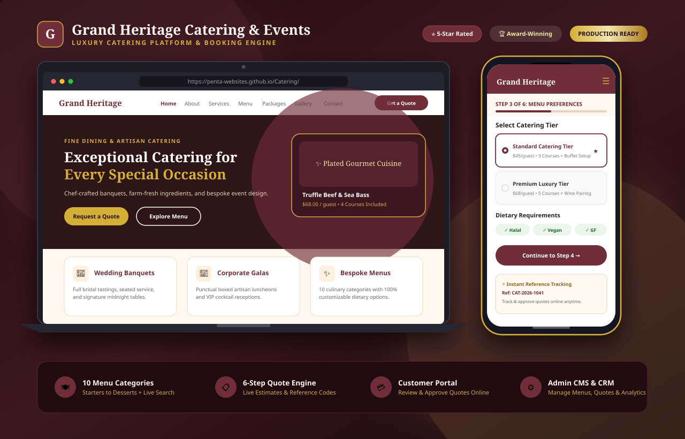

# Grand Heritage Catering & Events - Complete Luxury Catering Platform & Booking CMS

[-003B57?style=for-the-badge&logo=sqlite)](https://www.sqlite.org/)

---

## 🌐 Live Demonstrations

Experience the production website live on GitHub Pages:
- **Penta-Websites**: [https://penta-websites.github.io/Catering/](https://penta-websites.github.io/Catering/)
- **Pixel-Force**: [https://pixel-force.github.io/Catering/](https://pixel-force.github.io/Catering/)

> **Offline & GitHub Pages Zero-Downtime Guarantee**: The front-end includes an intelligent dual-mode engine (`js/data-fallback.js`). When deployed to static hosts like GitHub Pages, all 10 menu categories, interactive dietary filters, 6-tier package catalogs, dynamic lightbox galleries, testimonials, multi-step booking forms, customer status portal, and even the admin dashboard operate client-side without requiring an active backend server!

---

## 💎 Brand Identity & Visual Aesthetics

Grand Heritage Catering is styled with a warm, prestigious culinary aesthetic designed to build instant trust with bridal, corporate, and private clientele:

| Color Role | Hex Code | Swatch | Purpose |
| :--- | :--- | :---: | :--- |
| **Primary** | `#702D3A` |  | Deep Burgundy — Elegance, passion, culinary luxury |
| **Secondary** | `#FFF8EF` |  | Warm Cream — Soft, appetizing background warmth |
| **Accent** | `#C69A5B` |  | Golden Beige / Champagne — Premium finish & CTAs |
| **Text** | `#292929` |  | Dark Charcoal — High legibility & sophisticated typography |
| **Surface** | `#FFFFFF` |  | Crisp White — Clean cards, modals, and elevation |

- **Headings Font**: *Playfair Display* (Editorial luxury serif)
- **Body Font**: *Plus Jakarta Sans* (Clean, modern geometric sans-serif)

---

## 🚀 Key Modules & Architecture

### 1. Public Multi-Page Website
- **Homepage (`index.html`)**: Complete 14-section experience featuring Sticky Nav, Hero Banner with dual CTAs, Introduction story, 8 Catering Services, Featured Popular Menu, Package Tiers, Why Choose Us, 6-Step "How It Works" workflow, Event Gallery Preview, Verified Testimonials, Interactive FAQ Accordion, Call-to-Action banner, and Comprehensive Footer with social & WhatsApp links.
- **About Us (`about.html`)**: Heritage background, executive culinary team bios, farm-to-table sourcing philosophy, and food safety standards.
- **Catering Services Hub (`services.html`)** & **6 Dedicated Service Pages**:
  - [Wedding Catering](services/wedding-catering.html): Plated service, bridal tastings, midnight stations.
  - [Corporate Catering](services/corporate-catering.html): Executive boxed meals, board meetings, annual galas.
  - [Birthday Catering](services/birthday-catering.html): Themed dessert tables, family buffets, finger food.
  - [Private Party Catering](services/private-party-catering.html): In-home private chef dinners, cocktail parties.
  - [Outdoor Catering](services/outdoor-catering.html): Live grill BBQ, garden tents, weather-proof setups.
  - [Buffet Catering](services/buffet-catering.html): Grazing stations, chafing dish displays, carving stations.
- **Culinary Menu Catalog (`menu.html`)**:
  - 10 structured food categories (Starters, Main Courses, Rice & Biryani, BBQ & Grill, Pasta, Salads, Desserts, Beverages, Vegetarian, Special Dietary).
  - Instant live keyword search.
  - Dietary filter pills (Halal, Gluten-Free, Vegan, Dairy-Free, Nut-Free).
  - Floating Quote Tray: Add dishes directly into inquiry quote requests.
- **Catering Packages (`packages.html`)**:
  - Basic ($28/guest), Standard ($45/guest), Premium ($68/guest), Wedding Elegance ($85/guest), Corporate Luncheon ($38/guest), and Custom Bespoke Tier.
- **Interactive 6-Step Quote Booking Wizard (`quote.html`)**:
  - Step 1: Customer Contact & Company Information.
  - Step 2: Event Details (Date, Time, Venue, Guests, Indoor/Outdoor).
  - Step 3: Catering Preferences & Dietary Requirements (Halal, Vegan, GF).
  - Step 4: Hospitality Add-Ons (Waiters, Dinnerware, Buffet Setup, Live Stations).
  - Step 5: Budget Range & Preferred Payment Method.
  - Step 6: Live Summary Review & Instant Reference Generation (e.g., `CAT-2026-1041`).
- **Customer Self-Service Portal (`portal.html`)**:
  - Lookup any inquiry by reference number.
  - Real-time status tracker (`In Review`, `Quotation Sent`, `Booking Confirmed`).
  - View itemized formal quotations with taxes and deposit breakdown.
  - One-click online Quote Acceptance / Decline with instant status update.
- **Formal Printable Quotation (`quotation-view.html`)**:
  - Print & PDF download layout with itemized line items, valid-until date, and signature block.
- **Photo Gallery (`gallery.html`)**:
  - Masonry grid with category filter buttons and full-screen lightbox preview.
- **Customer Testimonials (`testimonials.html`)**:
  - Client reviews with verified 5-star ratings and public "Submit a Review" modal.
- **Contact & Map (`contact.html`)**:
  - Real-time contact form, interactive Google Maps embed, phone, WhatsApp direct click, and operating hours.

---

### 2. Comprehensive Admin Dashboard & CMS (`admin/`)
- **Dashboard Overview**: Key metrics (Total Inquiries, Bookings, Pipeline Revenue, Average Guest Count) and recent activity feed.
- **Inquiries Manager**: Filter by status, search by client/reference, slide-out drawer with event timeline, and CSV export.
- **Quotation Generator**: Create bespoke quotes with itemized line items, automatic tax/deposit calculations, PDF preview, and email dispatch logging.
- **Menu Management**: Real-time CRUD for dishes with instant stock availability toggles.
- **Package Management**: Edit pricing, guest counts, included courses, and featured badges.
- **Customer Directory**: CRM database with lifetime inquiries, bookings, and spend history.
- **Review Moderation**: Approve or hide public testimonials.
- **CMS Website Settings**: Update company phone, email, WhatsApp, operating hours, and tax rates without code edits.

---

## 🛠️ Technology Stack

- **Frontend**: Modern Vanilla JavaScript (ES6+), HTML5 Semantic Architecture, Tailwind CSS CDN with custom luxury palette extensions, Font Awesome 6 Pro icons, Google Fonts (*Playfair Display* & *Plus Jakarta Sans*).
- **Backend**: Node.js & Express REST API router with CORS and JSON body-parsers.
- **Database**: SQLite3 database (`data/catering.db`) with Write-Ahead Logging (WAL) and foreign key integrity.
- **Authentication**: JWT (JSON Web Tokens) with 24-hour expiration and bcrypt password hashing (12 salt rounds).
- **Offline Engine**: `js/data-fallback.js` for zero-downtime offline execution and static hosting (GitHub Pages).

---

## 💻 Local Quick Start

### Prerequisites
- Node.js (v18.0 or higher)
- npm

### 1. Clone & Navigate
\`\`\`bash
git clone https://github.com/Penta-Websites/Catering.git
cd Catering
\`\`\`

### 2. Install Dependencies & Launch
On Windows:
\`\`\`cmd
npm.cmd install
launch-catering.bat
\`\`\`
Or on Mac / Linux / PowerShell:
\`\`\`bash
npm install
node server/server.js
\`\`\`

### 3. Open in Browser
- **Public Website**: [http://localhost:3000](http://localhost:3000)
- **Admin Dashboard**: [http://localhost:3000/admin](http://localhost:3000/admin)
- **Customer Portal**: [http://localhost:3000/portal?ref=CAT-2026-1041](http://localhost:3000/portal?ref=CAT-2026-1041)

### 🔑 Default Admin Credentials
- **Username**: `admin`
- **Password**: `admin123`

---

## 🧪 Automated Test Suite

A comprehensive test suite verifies API integrity, database persistence, and quotation state machines:
\`\`\`cmd
node test-suite.js
\`\`\`
- `Categories API`: 10 categories verified.
- `Menu Catalog`: 20 gourmet dishes verified.
- `Packages Tier`: 6 tiers with included items verified.
- `Portal Inquiry Lookup`: Reference tracking verified.
- `Admin Auth & JWT`: Login and token verified.
- `Inquiry Engine`: Full 6-step payload persistence verified.
- `Client Quote Acceptance`: State change to `Accepted` verified.
- `Dashboard Analytics`: Metric aggregation verified.

---

## 📄 License
Released under the MIT License. Copyright &copy; 2026 Grand Heritage Catering & Events.
